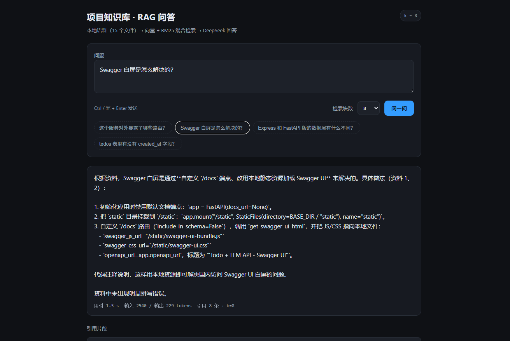
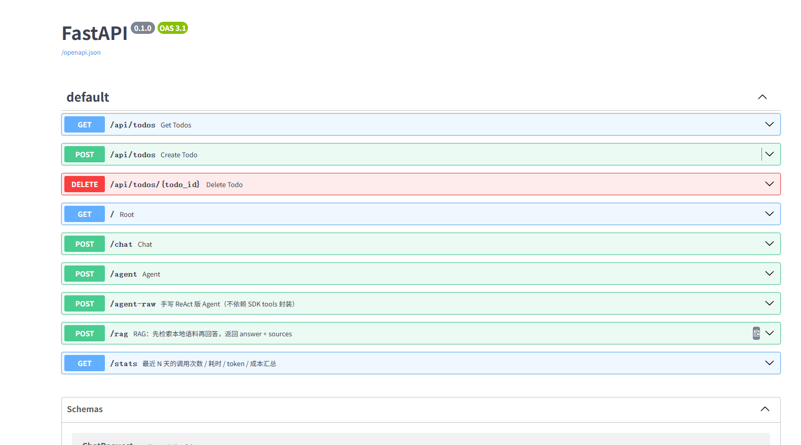

# Todo + Agent + RAG

一个 FastAPI 待办服务：SQLite 持久化、SSE 流式对话、Function Calling、手写 ReAct，
外加本地 RAG 问答（Chroma + 混合检索）与 MCP 工具化。带一套可复现的评测。

## 功能

| 能力 | 实现 |
|---|---|
| 待办 CRUD | `GET/POST/DELETE /api/todos`，SQLite 持久化（`todos.db`，可用 `TODO_DB` 覆盖） |
| 多轮流式对话 | `POST /chat`（SSE，逐 token 推送） |
| Function Calling | `POST /agent`（OpenAI 兼容 `tools` + `tool_choice="auto"`） |
| 手写 ReAct | `POST /agent-raw`（自行解析 `Thought/Action/Action Input/Observation/Final Answer`，最多 5 步） |
| RAG 问答 | `POST /rag`（混合检索 → 拼接上下文 → 回答 + `sources` 引用） |
| 演示页 | `GET /rag-ui`（单文件，无 CDN 依赖） |
| 本地文档 | `GET /docs`（Swagger 静态资源自托管，不依赖境外 CDN） |
| MCP server | `mcp_server.py`（stdio，5 个工具 + 2 个资源） |
| 可观测 | 事件日志（JSONL）+ `GET /stats` 汇总 + `GET /stats-ui` 面板（次数 / 延迟 / p95 / token / 成本） |

## 截图

**RAG 演示页**：提问 → 答案 → 引用片段（文件 + 行号 + 距离）



**Swagger 文档**：`/docs` 自托管静态资源



## 架构

```
                     ┌────────────────────────────┐
 浏览器 / curl ──────▶│ FastAPI (main.py)          │
                     │  /api/todos  /chat         │
                     │  /agent  /agent-raw  /rag  │
                     └───────┬───────────┬────────┘
                             │           │
                  SQLite ────┘           └──── OpenAI 兼容 API（deepseek-chat）
                (todos.db)                      ▲
                                               │
   /rag ──▶ retrieve(question, k=8)            │
             ├─ 向量：bge-small-zh（fastembed，512 维，本地）
             ├─ 关键词：BM25（纯标准库）
             ├─ 融合：RRF + 两条覆盖规则
             └─ Chroma 持久化（chroma_db/，约 47 块 / 15 个文件）
```

## 评测结果

10 题、三种条件、题均分（评测集见 `evals/rag-eval-10.md`）：

| 条件 | 分数 | 幻觉题数 | 平均输入 token |
|---|---|---|---|
| ① 不给上下文 | 1.00 / 10 | 6 | 42 |
| ② 全文塞进 prompt（上限） | 9.42 / 10 | 0 | 7,195 |
| ③ RAG（k=8） | **8.56 / 10**（3 次运行：8.67 / 8.33 / 8.67） | **0** | **2,171（-70%）** |

检索层（文件级）：**hit@3 = 10/10，hit@5 = 10/10，MRR = 0.90**。

分析记录：

- `evals/comparison-v1-v2.md` —— 版本锚定与可复现性实验
- `evals/rag-v1-report.md` —— 检索设计、纯向量失效分析、切块策略对比
- `evals/q8-prompt-ab.md` —— 提示词 A/B/C 对比与假纠正分析

## 前端（React）

`web/` 是一个 Vite + React 的单页应用：提问、答案、引用片段、历史记录（localStorage）。

```powershell
# 1) 先起后端（另一个终端）
.\.venv\Scripts\python.exe -m uvicorn main:app --port 8000

# 2) 起前端
cd web
npm install
npm run dev        # http://127.0.0.1:5173（/rag 代理到 :8000）
```

也可以 `npm run build` 后直接用后端托管：<http://127.0.0.1:8000/app>（`web/dist` 存在时自动挂载）。

## MCP

| 工具 | 读/写 | 说明 |
|---|---|---|
| `list_todos` | 读 | 全部待办 |
| `add_todo(name)` | 写 | 新增一条 |
| `delete_todo(todo_id)` | 写 | 删除 |
| `search_docs(query, k)` | 读 | 混合检索，返回文件名 + 行号 + 片段 |
| `ask_docs(question, k)` | 读 | 检索 + 回答 + 引用 + token 用量 |

资源：`todos://all`、`docs://index`。key 通过环境变量或 Windows 凭据管理器读取，配置中不含明文。

注册到 Codex（`~/.codex/config.toml`）：

把 `<repo>` 换成实际克隆目录：

```toml
[mcp_servers.todo_rag]
command = '<repo>\.venv\Scripts\python.exe'
args = ['<repo>\mcp_server.py']
enabled = true
```

## 快速开始

```powershell
git clone git@github.com:Aozak1Aok0/todo-rag.git
cd todo-rag

python -m venv .venv
.\.venv\Scripts\python.exe -m pip install -r requirements.txt

# key：Windows 上可以完全不设 —— 会自动读 Windows 凭据管理器（WorkBuddy/DeepSeek，可用 CRED_TARGET 覆盖）。
# 其他系统或想覆盖时：$env:DEEPSEEK_API_KEY = "<your key>"

.\.venv\Scripts\python.exe -m uvicorn main:app --reload
# 页面 http://127.0.0.1:8000/rag-ui · 文档 http://127.0.0.1:8000/docs
```

RAG 使用 `corpus/` 下的 15 个文件作为评测语料快照；需要本地 embedding 模型（约 91MB，不入库，见 `models/README.md`），然后建索引：

```powershell
.\.venv\Scripts\python.exe rag\rag.py build
```

## 测试

```powershell
.\.venv\Scripts\python.exe tests\smoke_test.py       # CRUD / 持久化 / 校验 / agent 读库
.\.venv\Scripts\python.exe tests\e2e_restart.py      # 起两次 uvicorn，验证跨进程持久化
.\.venv\Scripts\python.exe tests\mcp_smoke.py        # MCP 工具与资源（--with-llm 会跑一次真实问答）
.\.venv\Scripts\python.exe tests\obs_smoke.py        # 事件日志 → /stats 汇总
.\.venv\Scripts\python.exe evals\retrieval_eval.py   # 检索层指标（秒级，不调用模型）
```

## 目录

```
main.py              接口（CRUD / chat / agent / agent-raw / rag / stats）
store.py             待办数据层（Web 与 MCP 共用）
mcp_server.py        MCP server（stdio）
credentials.py       从 Windows 凭据管理器读取 key
obs.py               事件日志与汇总
embed.py             本地 embedding（bge-small-zh）
rag/                 切块、索引、混合检索、提示词
evals/               10 题评测集、baseline 与 RAG 结果、分析报告
corpus/              评测语料快照（15 个文件，供检索索引使用）
tests/               冒烟测试（接口 / 持久化 / MCP / 观测）
docs/                设计与迁移说明、截图
static/              rag.html + Swagger 静态资源
web/                 React 前端（Vite，开发时 npm run dev）
models/              本地 embedding 模型（不入库）
```

## 已知限制

- `/rag` 为非流式；检索是同步实现，已在服务端放入线程池，但未做并发压测。
- 使用 24M 中文 embedding 模型，对英文代码标识符区分度有限；检索层用 BM25 补齐。
- 评测集为 10 题，单次运行波动约 ±0.3 分，结论以多次运行与粗指标为准。
- `todos` 无用户概念；`/redoc`、`/openapi.json` 尚未纳入路由清单的评测锚点。

## License

MIT — see [LICENSE](LICENSE).
